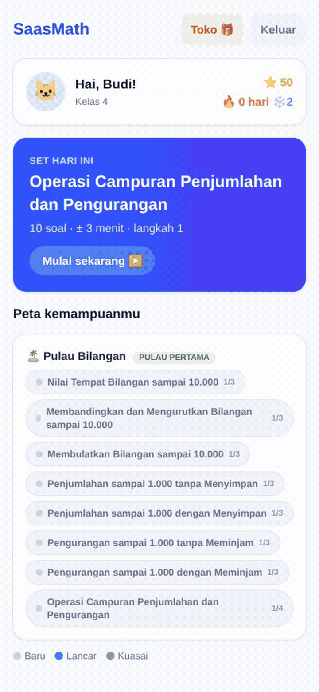
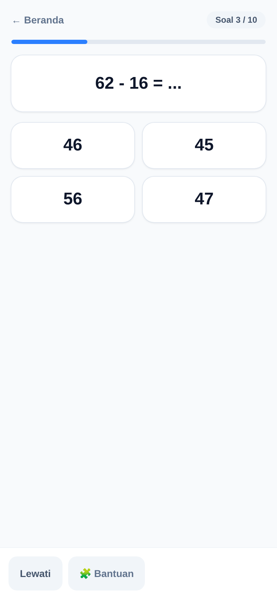
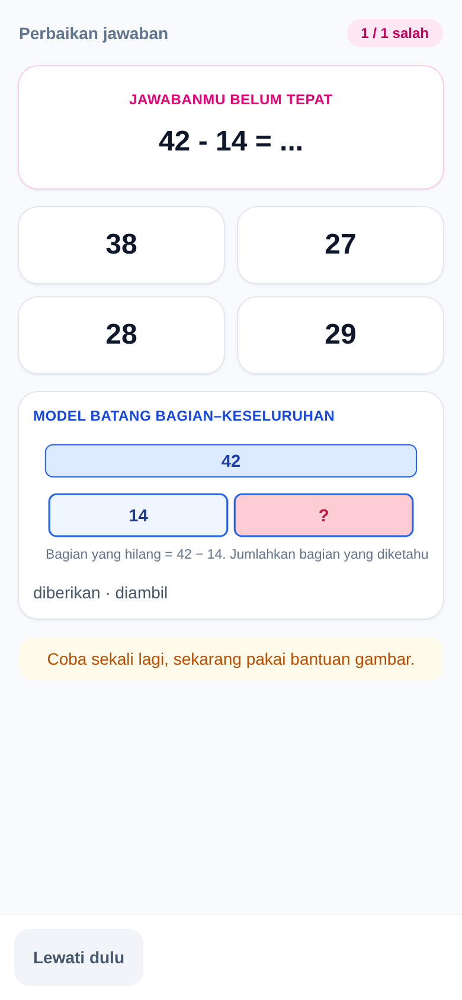
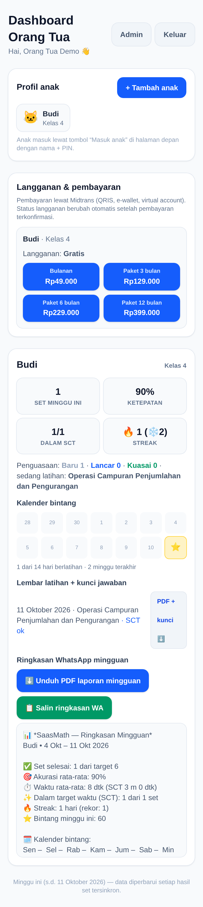

# SaasMath

[](https://github.com/falconrapid19925/saasmath/actions/workflows/ci.yml)
[](https://github.com/falconrapid19925/saasmath/releases)
[](LICENSE)
[](package.json)
[](CONTRIBUTING.md)



| Drill in play | Bar-model CPA hint (model batang) |
| :---: | :---: |
|  |  |
|  | |

**[Try the static demo](https://falconrapid19925.github.io/saasmath/)**: a GitHub Pages landing page (Bahasa Indonesia) with a playable drill that runs the real engine in the browser (`generateSet`, `gradeItems`). The full app needs a server, and the page says so.

SaasMath is a web app (PWA) for Indonesian children in kelas 4-6 SD. Each day the child plays one timed 10-15 minute math drill, built the way Kumon works. A ladder of small-step sets carries the curriculum, and each set has a Standard Completion Time (SCT) target. A mastery gate decides advancement, and a failed gate repeats the set as a freshly generated variant.

Grading is instant and wrong answers trigger same-session self-correction. When a child stays stuck, a Singapore-math CPA layer intervenes and the same problem returns as a pictorial bar model (model batang) before the abstract form. A streak, stars, and a toko give the loop its gamification.

The content is aligned to Kurikulum Merdeka Fase B/C and sold direct to parents in Bahasa Indonesia. Prices from `src/lib/checkout-prices.ts`: Rp49.000 for one month, Rp129.000 for three, Rp229.000 for six, Rp399.000 for twelve. The PWA caches the last offered set, so a drill still runs with no network and queued submissions sync when connectivity returns.

## Running it

Requirements: Node 26 (the seed script uses Node's native TypeScript stripping) and npm.

```bash
npm install
npm run db:push   # create/update dev.db (SQLite, repo root) from src/db/schema.ts
npm run db:seed   # idempotent: 59 skills, 12 shop items, demo account
npm run dev       # Next.js dev server
```

The seed prints the demo login: parent `demo@saasmath.id`, child Budi, PIN 123456. Children sign in with name plus a 6-digit PIN, one policy shared by the server schema (`lib/server/schemas.ts:pinSchema`), the server actions, the API routes, the `PinPad` component, and the seed. Re-running `db:seed` upserts content by stable id and never resets demo state.

Set `AUTH_SECRET` before the first login: copy `.env.example` to `.env.local` and replace the value with at least 32 random chars. `src/lib/auth.ts` signs every session token with it and throws when it is missing or short. Optional env, all stub-safe without them: `DB_PATH` (default `dev.db`), `MIDTRANS_SERVER_KEY`, `MIDTRANS_IS_PRODUCTION`, `WHATSAPP_TOKEN`, `WHATSAPP_PHONE_NUMBER_ID`.

Other scripts: `npm run build`, `npm start`, `npm run db:generate` (drizzle-kit SQL migrations into `drizzle/`), and `npm run site:build` (esbuild-bundles `site/` into `site-dist/` for the GitHub Pages deploy from the `ghpages` branch, see `.github/workflows/pages.yml`). Test and check commands are in [Tests](#tests).

## Architecture

```
src/
  data/          authored content: skill graph (kelas4/kelas5), zod step-param
                 schemas and monotonicity rules, shop, demo account
  db/            schema.ts (all tables) + index.ts (lazy better-sqlite3 client)
  lib/engine/    the drill engine, pure and framework-free: families-*.ts (12
                 generator families), placement.ts (diagnostic ladder), set.ts,
                 gates.ts, sct.ts, answers.ts (grading, rng)
  lib/server/    the API layer: attempts.ts (shared submit/sync pipeline),
                 engine.ts (server-side set regeneration), family-params.ts
                 (authored params into the engine), curriculum.ts + island.ts
                 (paywall gating), gate.ts, elo.ts, sm2.ts, sct.ts, streak.ts,
                 authz.ts, midtrans.ts, whatsapp.ts
  lib/client/    browser-side view models, API client, hint normalizer
  app/api/       route handlers (auth, session/next, session/submit, sync,
                 placement, checkout, digest/preview, sets/[id]/pdf)
  app/anak|orangtua|masuk/   child home, parent dashboard, login screens
  components/    drill player, hint SVGs (hints/HintView.tsx), answer inputs
```

`POST /api/session/next` resolves the child's island access (`curriculum.ts` and `island.ts`), picks the next task in `nexttask.ts` (progression, CPA mode, or SM-2 review), and regenerates the exact set server-side from (skillId, step, seed). Authored params from the skills table pass through `family-params.ts` into `lib/server/engine.ts:generateSetItems`, and the response carries the items plus the tightened SCT (`sct.ts:servedSctSeconds`). The child plays in `components/drill` (timer, hints, self-correction). `POST /api/session/submit`, or `POST /api/sync` for offline-queued sets, runs the same pipeline in `attempts.ts:processAttempt`: regenerate, re-grade server-side with `answers.ts:gradeItems`, decide the gate (`gate.ts` over engine `gates.ts`), then write the attempt row, mastery update, streak, and stars in one transaction. Nothing the client sends is trusted, and `implausibility.ts` flags statistically implausible syncs.

- Placement offers `GET/POST /api/placement` over `lib/engine/placement.ts`: 10 rungs x 2 items, stop on the first failed rung, place on the last cleanly passed rung (deliberately low), clamped to a rung whose skill exists and is island-accessible.
- The last offered set is cached per child, so a cold start with no network replays it, clearly labeled (`components/drill/useDrillSession.ts`, `lib/client/outbox.ts`). Submissions made offline queue in the outbox and drain through `POST /api/sync` when connectivity returns. A record the server permanently rejects stops retrying at the outbox's cap, dead-letters, and shows in `components/SyncIndicator.tsx` as **gagal disinkronkan**.
- A set is fully determined by (skillId, step, seed). Generators draw every random choice from the passed Rng, so any worksheet, including a past attempt's, regenerates identically for replay and PDF export (`sets/[id]/pdf`, pdf-lib).
- Launch runs on local SQLite via `better-sqlite3` and Drizzle ORM, with WAL for concurrent readers and request-time connections only (`db/index.ts`, never at build time). `src/db/schema.ts` is written 1:1 portable to Postgres for a planned Supabase move. Swap `drizzle-orm/sqlite-core` imports for `pg-core` per the schema header notes (`text({ mode: "json" })` to `jsonb`, `integer({ mode: "boolean" })` to `boolean`, `integer({ mode: "timestamp" })` to `timestamp`), point `db/index.ts` at `drizzle-orm/node-postgres` or the Supabase pooler, run `npm run db:generate`, apply to Supabase (Singapore region), and re-run `db:seed`, which upserts by stable id. Text UUID primary keys and column names carry over unchanged. Parents can move to Supabase Auth or keep the current scrypt auth (`lib/auth.ts`) with no schema change, and the frontend can sit on Vercel or Cloudflare.

## Drill loop

| Rule | Where |
|---|---|
| On-demand sets from parameterized templates in small-step ladders | `lib/engine/set.ts`, `lib/engine/families-*.ts`, authored ladders in `data/skills/`, bridge `lib/server/family-params.ts` |
| SCT target per set, recalibrated to the 75th percentile after ~100 completing attempts per skill across all children | `lib/engine/sct.ts` (`computeSct`, `calibrateSct`), `lib/server/sct.ts`, `attempts.ts:sctCalibrationSample` |
| Gate rules: advance at >=95% within SCT, accurate but over SCT tightens ~10% for 3 cycles then promotes with a fluency flag, below 80% enters CPA mode, two clean CPA passes exit | `lib/engine/gates.ts` (`GATES`, `decideGate`, `foldGateHistory`) applied via `lib/server/gate.ts` |
| CPA hint models, five fixed: part-whole, comparison, fraction-bar, number-line, base-ten | payloads built by `lib/engine/families-shared.ts`, validated by `lib/client/hints.ts:normalizeHint`, rendered as SVG in `components/hints/HintView.tsx` |
| Review scheduling (SM-2) and Elo on mastered skills | `lib/server/sm2.ts`, `lib/server/elo.ts`, woven into `attempts.ts` and `nexttask.ts` |
| Gamification: streak, star ledger, toko | `lib/server/streak.ts`, `attempts.ts:applyStreakAndStars`, `db/schema.ts` (`streaks`, `stars_ledger`, `shop_items`), `app/anak/toko` |
| Sync integrity for offline sets | `app/api/sync/route.ts` reusing `processAttempt`, duplicate detection (409), `lib/server/implausibility.ts` |

References like "plan 6" point at the internal design document that seeded this repo. It ships in the public git history, not the working tree.

## Payments and WhatsApp

- With `MIDTRANS_SERVER_KEY` set, checkout performs the documented Snap call from `lib/server/midtrans.ts` (QRIS, VA, e-wallet). The webhook at `POST /api/webhooks/midtrans` checks the signature (`verifyNotificationSignature`) and activates the subscription (`applyMidtransNotification`).
- Without a key, checkout records a `pending` subscription row and returns a placeholder payload documenting where the Snap call goes. The webhook accepts one documented dev-only payload, `{"dev_simulate": true, "order_id", "transaction_status"}`, so the activation boundary stays testable locally. The flag is ignored the moment a server key is configured.
- A free child's first checkout starts the 7-day trial in the same transaction (`createOrder`). Only a `free` plan with no trial end picks one up, exactly once.
- Without `WHATSAPP_TOKEN` and `WHATSAPP_PHONE_NUMBER_ID`, `sendWhatsAppText` (`lib/server/whatsapp.ts`) is a no-op that logs the rendered digest, so `/api/digest/preview` and the parent dashboard run end-to-end with zero external calls. With creds it posts a free-form Cloud API text. Production should use an approved utility template (template categorization is an open risk). The schema does not store parent phone numbers yet, so the preview route passes `null` as recipient.

## Tests

```bash
npm test            # vitest: unit and seam tests, colocated with the code under src/
npm run test:e2e    # Playwright suite in tests/e2e/
npm run typecheck   # tsc --noEmit
npm run lint
```

The vitest suite covers the engine generators, the authored content graph (`src/data/content.test.ts`), the server write path on an in-memory SQLite harness (`src/lib/server/test-db.ts`), route handlers, and the client layer. `tests/helpers/verifyItem.ts` re-derives each generated item's expected answer from its own prompt and compares it with `answersEqual`. The authored-to-engine bridge is probed skill-by-skill in `src/lib/server/family-params.test.ts`, and generated hint payloads run through the client normalizer (`normalizeHint`).

The Playwright suite (`tests/e2e`: journey, offline-sync, paywall, pdf, shop) builds and serves a production bundle against a fresh temp SQLite DB (`tests/e2e/web-server.mjs`). The service worker registers only in production builds, and the offline journey depends on it.

## CI and releases

Every push and PR runs the [CI workflow](.github/workflows/ci.yml): lint and typecheck, unit tests with v8 coverage (summary table on the run page, lcov/json as artifacts), a production build, and the Playwright e2e suite. Dependabot keeps npm dependencies and pinned action versions current.

Releases are tag-driven. Push a `v*` tag and the [Release workflow](.github/workflows/release.yml) re-runs the full gate, then publishes a GitHub release with generated notes. `workflow_dispatch` on either workflow is the dry run: same checks, nothing published. See [Releases](https://github.com/falconrapid19925/saasmath/releases).

## Contributing and license

See [CONTRIBUTING.md](CONTRIBUTING.md) for setup, the pre-PR checklist, and commit and release conventions. MIT, see [LICENSE](LICENSE).
